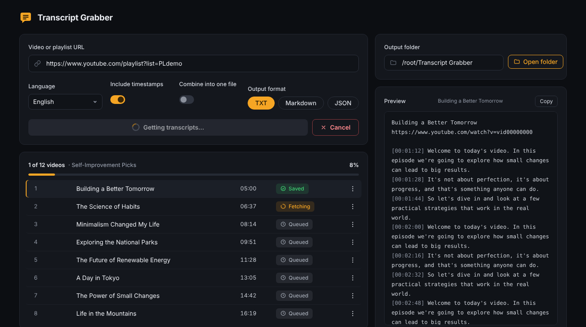
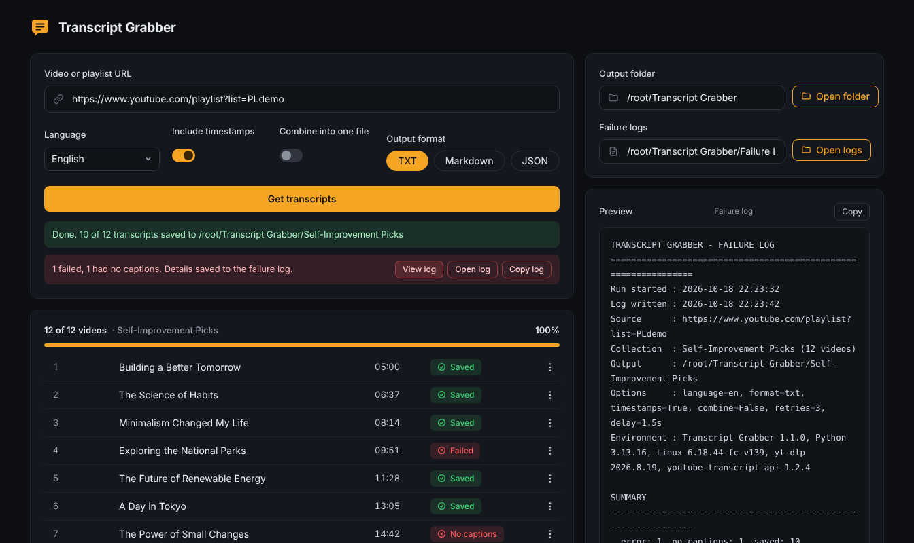

# Transcript Grabber (YTG)

**Paste a YouTube link and get its transcript saved as a text file.** It works for one video, a whole playlist, or an entire channel. Each video becomes a clean, readable file on your computer that you can search, study, take notes from, or feed into other tools.

Everything runs on your own computer through a simple web page in your browser. There's no account and no cloud service, and you never have to touch the command line unless you want to.



## Features

- **Any link:** a single video, a playlist, or a channel. Playlists and channels are expanded automatically.
- **Formats:** TXT, Markdown (timestamps link back to that moment in the video), or JSON.
- **Layout:** timestamps on or off, and one file per video or everything combined into one.
- **Language:** choose the transcript language; when only another language exists, it falls back to YouTube's auto-translation.
- **Live progress:** see where the run is, preview each transcript as it arrives, and retry anything that failed.
- **Cancel anytime:** use the **Cancel** button or press **Esc**. Nothing already saved is lost.
- **Resume:** run the same playlist again and it skips what you already have.
- **Hard to block:** if YouTube blocks the fast caption method, it switches to yt-dlp automatically. It can also use your browser's YouTube cookies for stubborn cases.
- **Failure logs:** when anything fails, a detailed log is saved automatically. It records what failed, why, the full error, and a ready-made retry list. You can view, copy, or open it right from the app.

## Start it

**Windows:** double-click `Start Transcript Grabber.bat`.
**macOS / Linux:** run `./start.sh`.

The first run creates a private Python environment (`.venv`) and installs the two packages it needs, which takes about a minute. After that it opens **http://127.0.0.1:8765** in your browser. Keep the console window open while you use it; close it to quit.

You'll need Python 3.9 or newer (python.org). On Windows, tick "Add python.exe to PATH" during install.

## Use it

1. Paste a video, playlist, or channel URL.
2. Choose the language, timestamps on or off, one file per video or one combined file, and the format.
3. Click **Get transcripts**. Click any row to preview it. The **⋮** menu can open the file, open the video, or retry a failed one.
4. Changed your mind? Click **Cancel** (or press **Esc**). It stops right away, and every transcript saved so far stays saved.

Files go to `~/Transcript Grabber` by default (you can change this in the app). A playlist gets its own subfolder, with files numbered in playlist order: `001 - Title.txt`.

### When something fails



If any video fails or has no captions, the app saves a **failure log** to `~/Transcript Grabber/Failure Logs` (change it under **Failure logs** in the app). A red bar under the progress area tells you what happened and gives you three buttons:
- **View log:** shows the log in the preview pane.
- **Open log:** opens the file in your text editor.
- **Copy log:** puts the whole log on your clipboard, ready to paste into an email, an issue, or a chat.

Each log lists the run's settings and environment (app, Python, and library versions), a summary, every failed video with its reason, number of attempts, and full error chain, and a **retry list** of URLs you can feed back in with `--urls-file`. There's one log per run, named by date and time. Retrying a video from the app updates that same log, and if the retries fix everything, the log is removed.

### When YouTube blocks you

YouTube sometimes refuses caption requests, even from a home connection. The failure log tells you which kind of refusal it was, and the app reacts differently to each:

| Log says | What it means | What the app does | What you do |
|---|---|---|---|
| *blocking requests from this IP* | The lightweight caption library was blocked | Switches to **yt-dlp**, a full YouTube extractor that's much harder to block, for the rest of the run | Nothing, usually |
| *rate-limiting caption downloads (HTTP 429)* | Too many caption downloads from your IP recently | Waits 75 s and retries once (shown as **Waiting** in the list), pauses 2 minutes before the next video, and stops the run if two videos in a row are rate-limited | **Stop for at least an hour.** Every attempt restarts YouTube's cooldown. Then turn on cookies and try once. |
| *confirm this isn't a bot* | YouTube wants a signed-in browser | Fails right away, since retrying without cookies can't help | Turn on cookies, then **Retry** |
| *Couldn't read … cookies* | The browser's cookie file was locked or encrypted | Fails right away with the reason | Close that browser completely, or use Firefox or a cookies.txt file |

**Turning on cookies.** Requests made with your YouTube sign-in get far higher limits. Under **If YouTube blocks you**, pick one:
- **Firefox cookies** is the most reliable browser option. Close Firefox first.
- **Chrome, Edge, or Brave cookies** often fail on Windows, because those browsers encrypt their cookies in a way other programs can't read. When they fail, use a cookies.txt file.
- **A cookies.txt file** works with any browser. Install a browser extension that exports cookies in Netscape cookies.txt format (yt-dlp's FAQ lists recommended ones), open youtube.com while signed in, export, and paste the file's path into the box that appears. **Treat that file like a password:** it *is* your YouTube login. This repo's `.gitignore` keeps it out of commits.

With cookies on, the app goes straight to yt-dlp, since only yt-dlp can use them.

Also make sure no VPN is on, since VPN addresses are blocked far more often.

The launcher installs **Deno**, the JavaScript runtime yt-dlp needs to work fully with YouTube. If the app warns that it's missing, close it and run the launcher again.

## Command line

```
python transcript_grabber.py "PLAYLIST_OR_VIDEO_URL"
python transcript_grabber.py URL --format md --no-timestamps --out "D:\Transcripts"
python transcript_grabber.py URL --combine --lang es
python transcript_grabber.py --urls-file links.txt
python transcript_grabber.py URL --cookies-from-browser firefox
python transcript_grabber.py URL --cookies "C:\Users\you\Downloads\youtube_cookies.txt"
python transcript_grabber.py URL --source ytdlp
```

Run `python transcript_grabber.py --help` to see every option. Press Ctrl+C to stop. Use `--log-dir` to choose where failure logs go; the path of any log is printed at the end of the run.

## Good to know

- **Captions required:** it only works on videos that have captions (uploaded or auto-generated). Videos without captions show **No captions**.
- **Throttling:** YouTube slows down bulk requests. The app waits about 1.5 seconds between videos and backs off when it's blocked. If you see "Blocked by YouTube", wait a while and use **Retry**. It works best from a home connection; VPNs and cloud servers get blocked much more often.
- **Privacy:** the app only listens on your own computer (127.0.0.1) and only opens files it created.
- **Updates:** if YouTube changes something and lookups start failing, re-running the launcher updates both packages automatically.
- **Personal use:** transcripts belong to their creators. Keep them for your own study and notes, and don't republish them.

## How it's built

The short version: there's a Python core that does the work, a tiny local web server that drives it, and a single-page UI that polls the server for progress. The command line and the web UI share the same core.

[**docs/ARCHITECTURE.md**](docs/ARCHITECTURE.md) is the full engineering write-up: components, data flow, how cancellation works, the design decisions and their trade-offs, and how it's tested.

## Project layout

| File | What it is |
|---|---|
| `tg_core.py` | Core logic: playlist expansion, fetching, formatting, saving, cancellation |
| `app.py` | Local web server and job controller for the UI |
| `static/index.html` | The UI (HTML, CSS, and vanilla JavaScript in one file) |
| `transcript_grabber.py` | Command-line version |
| `test_core.py` | Offline tests: `python -m unittest test_core` |
| `Start Transcript Grabber.bat`, `start.sh` | One-click launchers that set up a virtual environment |
| `docs/` | Architecture write-up and screenshot |
