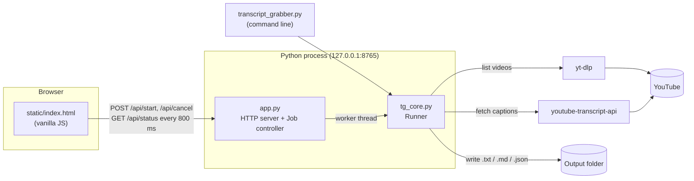

# How Transcript Grabber is built

This is the engineering view of the app: what problem it solves, how the pieces fit together, why it was built this way, and how it's tested.

## In plain terms

You give it a YouTube link. It works out which videos are behind that link, asks YouTube for each video's captions, tidies them into readable text, and saves one file per video. A small web page shows progress and lets you preview, retry, or cancel. It all runs on your machine.

## 1. The problem and the requirements

The goal is to turn "a YouTube URL" into "a folder of clean transcript files," reliably, for anything from 1 video to several hundred.

| Requirement | What it drove in the design |
|---|---|
| Accept a video, playlist, or channel URL | A URL-to-video-list step separate from fetching ("expansion") |
| Survive big playlists and flaky networks | Per-video isolation, retries with backoff, resumable output |
| Don't get the user's IP blocked | Throttling with jitter between requests |
| Be usable by non-developers | A one-click launcher and a browser UI, not just a CLI |
| Let the user stop at any time without losing work | Cooperative cancellation checked at every waiting point |
| Run only on the user's computer | A localhost-only server with no accounts and no cloud |
| Easy to maintain | A small codebase, two dependencies, stdlib for everything else |

## 2. Architecture



It's three layers, each with one job:

1. **Core (`tg_core.py`).** Pure logic with no UI code. It owns the data model (`Video`, `Collection`, `Segment`, `Options`), playlist expansion, fetching, formatting, and the `Runner` that processes a list of videos.
2. **Interfaces.** These are two thin shells over the same core:
   - `transcript_grabber.py`, a command-line interface built on `argparse`.
   - `app.py`, a local HTTP server, plus a `Job` controller that runs the core on a background thread.
3. **UI (`static/index.html`).** A single static page in plain HTML, CSS, and JavaScript with no build step. It talks to the server through a small JSON API.

Keeping the core free of UI code is what lets the CLI and the web app behave identically. It also lets the tests run the real core without a browser or a network.

## 3. How a run flows

1. **Start.** The UI sends `POST /api/start` with the URL and options. The `Job` controller starts a worker thread and immediately returns `{ok: true}`, so the browser never waits on YouTube.
2. **Expand.** `list_videos(url)` decides what the URL is:
   - **Single video:** the 11-character ID is pulled out with a regex, so no playlist call is needed.
   - **Playlist or channel:** yt-dlp runs in *flat extraction* mode, which lists entries without downloading anything. Channels come back as nested tabs (Videos, Shorts, and so on), so a recursive `_flatten` collapses them. Private and deleted entries are dropped.
3. **Process.** The `Runner` loops over the videos:
   - If the output file already exists, it marks the video **skipped**. This is what makes runs resumable.
   - Otherwise it waits (throttling), fetches the transcript, cleans it, renders it, and writes the file.
   - Every status change calls an `on_update` callback. The CLI prints a line; the web app just keeps the state for the next poll.
4. **Report.** The UI polls `GET /api/status` every 800 ms and re-renders the list, the progress bar, and the preview.

### Fetching and error handling

`fetch_transcript()` asks youtube-transcript-api for the list of available caption tracks and picks one:
- **Track choice:** the requested language first; failing that, a machine translation of any translatable track; with **Any available**, the first track.

It then converts the library's many exception types into **three outcomes the rest of the app understands**:

| Outcome | Examples | What the Runner does |
|---|---|---|
| `NoCaptions` | captions disabled, no transcript, video unavailable | Marks the video **No captions** and moves on with no retry, since retrying can't help |
| `Blocked` | YouTube is rate-limiting or blocking the IP | Retries with a long backoff (15 s, 30 s); if it still fails, marks the video failed and suggests waiting |
| Anything else | network blips | Retries with a short backoff (3 s, 6 s) |

Translating library-specific errors into a small set of domain errors is a deliberate boundary. When the library changes its exception names (it has before), only one function needs updating.

### Throttling

Between videos the runner waits `delay + random(0, 0.75)` seconds, 1.5 s by default. The random **jitter** keeps the request pattern from looking robotic, which matters more to YouTube's bot detection than raw speed does. Each video is fetched sequentially on purpose: parallel requests would be faster for about a minute, until the IP got blocked.

### Formatting

Raw captions are full of line breaks and doubled spaces, so `clean_text()` normalizes whitespace. Then one of three formats is rendered:

| Format | Shape |
|---|---|
| **TXT** | `[HH:MM:SS] line` per caption, or paragraphs when timestamps are off |
| **Markdown** | Same idea, but each timestamp is a link to `&t=<seconds>s`, so a click jumps to that moment in the video |
| **JSON** | Structured segments (`start`, `duration`, `text`) for feeding into other programs |

Without timestamps, `paragraphs()` builds readable prose. It starts a new paragraph when the speaker pauses for more than 2.5 s or the paragraph passes about 700 characters. That's a simple heuristic, but far easier to read than one caption per line.

File names are sanitized for Windows and macOS, and playlist files get a zero-padded index (`001 - `), so the folder sorts in playlist order.

## 4. Cancellation

Python can't safely kill a thread from outside, so cancellation is **cooperative**. The worker checks a flag at every point where it might be waiting:

| Check point | Why it's needed |
|---|---|
| Between videos | The obvious place to stop |
| During every wait | Throttle delays and retry backoffs are split into 0.2 s chunks, so even a 30 s backoff ends within 0.2 s of a cancel |
| Before each retry attempt | So a failing video doesn't start another attempt after the cancel |
| Right after each request returns | If the cancel arrived while a request was in flight, the result is discarded rather than saved, so "cancelled" means nothing new appears afterward |

When the loop exits, every video still queued is marked **Cancelled**. Files already written stay on disk, so re-running the same playlist resumes where it stopped. In combined mode, a partial combined file is written from whatever was fetched.

Two details in the `Job` controller make this safe:
- **A stop signal per run.** Each run gets its own `threading.Event`, so starting a new run can never "un-cancel" an old thread that's still finishing a slow request.
- **A generation counter.** Each run has a number, and a worker only writes back to the shared state if its number is still current. This matters most when you cancel while a large channel is still being listed: the UI resets instantly, and when the slow lookup eventually returns, its result is simply ignored.

The only thing cancel can't interrupt is a single in-flight HTTP request, which usually takes a second or two. During that moment the UI shows **Cancelling...**.

## 5. Design decisions and trade-offs

| Decision | Alternatives considered | Why this one |
|---|---|---|
| **Local web UI** (browser + localhost server) | Tkinter, Electron, PyQt | Browsers already do layout, fonts, and accessibility well. It looks modern with no GUI toolkit to install, and the same page would work if it were ever hosted. |
| **Stdlib `http.server`** (`ThreadingHTTPServer`) | Flask, FastAPI | The API is six endpoints, and a framework would add a dependency for no real benefit. `ThreadingHTTPServer` keeps polling responsive while a job runs. |
| **Polling every 800 ms** | WebSockets, Server-Sent Events | The state is small, there's one user, and polling is stateless and survives page refreshes for free: reload mid-run and the page picks the job back up. Push would add complexity for no visible gain. |
| **One background thread per job** | asyncio, multiprocessing | The work is I/O-bound and sequential by design (throttling). A thread is the simplest model that keeps the server responsive. |
| **yt-dlp for listing, youtube-transcript-api for captions** | YouTube Data API, scraping HTML | The official API needs an API key and quota, and its caption download only works for videos you own. These two libraries are maintained, widely used, and track YouTube's changes. |
| **Vanilla JS, single HTML file** | React or Vue with a build step | One file, nothing to compile or bundle, so you can open it and edit a color. The UI is small enough that a framework wouldn't pay for itself. |
| **File existence = progress record** | A database or state file | The output folder *is* the state. Resume needs no extra bookkeeping and can't drift out of sync with what's actually on disk. |
| **Launchers that create a `.venv`** | Asking users to `pip install` | Keeps dependencies isolated from the system Python, and upgrades the libraries on each launch, which is how YouTube-side breakages usually get fixed. |

## 6. Security

Even a local app deserves a threat model. A web page running on your machine is reachable by *other* websites open in your browser, through cross-site requests to `127.0.0.1`. Three defenses cover that:

1. **Bind to `127.0.0.1` only.** The server isn't reachable from your network.
2. **Origin check on every `POST`.** Requests from another site's origin get `403`, so a malicious page can't start jobs or open files.
3. **Allowlisted file opening.** The **Open file** and **Open folder** actions only open paths this app created during the current run, plus the output folder itself. An arbitrary path like `/etc` is refused.

The UI also escapes every value it puts into the page (video titles come from the internet), which prevents HTML injection.

## 7. Testing

The core takes its side effects as parameters: `Runner(fetcher=..., sleeper=..., should_stop=...)`. That's **dependency injection**, and it's what makes the logic testable without YouTube or real time:

- **Unit tests (`test_core.py`, 12 tests, run offline in milliseconds):**
  - Parsing video IDs from every URL shape, and sanitizing file names.
  - Output in all three formats, combined files, and paragraph building.
  - Resume (skips files that already exist).
  - Retries and backoff when blocked.
  - Cancellation: mid-run, during a long wait, and with an in-flight result discarded.
- **End-to-end tests:** a headless Chromium (Playwright) drove the real UI against the real server, with only YouTube swapped for a fake:
  - starting a run, previewing, and retrying,
  - cancelling mid-run, cancelling during playlist listing, and starting a new run right after,
  - the origin check and the path allowlist,
  - phone-width layout (no horizontal scrolling).

Run the unit tests with:

```
python -m unittest test_core
```

## 8. How it was made

1. **Design first.** The UI was designed as a high-fidelity mockup with Higgsfield's image generation (GPT Image), covering the dark theme, amber accent, status chips, and preview pane. The HTML and CSS were then built to match it.
2. **Core next.** The logic was written behind the injection points above, so it could be tested before any UI existed.
3. **Interfaces last.** The CLI and the web server are thin wrappers over the core.
4. **Then iterated:** for example, adding the Cancel button and the generation-counter logic that makes it safe.

The code was written with Claude (Anthropic's AI model) as a pair programmer. Herby set the requirements and the design direction, and reviewed the result; Claude drafted the code, tests, and documentation. Every decision in this document holds on its own engineering merits and can be checked in the code.

## 9. Known limitations and next steps

- **Captions required:** it can't produce transcripts for videos without captions. A future option could download the audio and transcribe it locally with Whisper.
- **One job at a time:** a queue of URLs exists only in the CLI (`--urls-file`). A UI queue would be a natural addition.
- **No proxy support yet:** youtube-transcript-api supports proxies, which would help heavy users who get blocked often.
- **Packaging:** a PyInstaller build could ship it as a single `.exe` with no Python install required.
